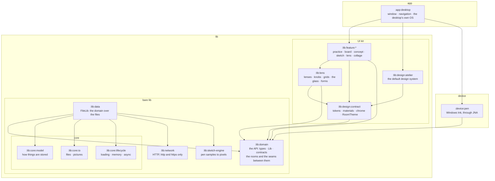
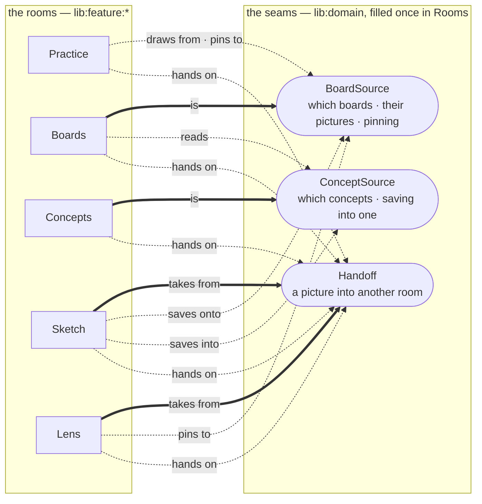

# ActionDraw's architecture

ActionDraw is built as Gradle modules in three groups. A module can use only what it declares as a
dependency, so the build — not a convention — holds the boundaries below. M10 in the
[roadmap](../ROADMAP.md) built it, step by step, each one broken on purpose to see its guards hold.

- **`lib`** — what an application builds on, in two halves:
  - the **bare lib**: `core` (`model`, `io`, `lifecycle`), `network`, `domain`, `data` and the
    `sketch-engine`. Headless, usable on its own, with no UI at all;
  - the **UI kit**: the design system (its contract and the default *atelier*), the *lens* that
    every room showing a picture sees it through, and the features, one per room — the convenient
    way of putting the bare lib to use, ready for a GUI.
- **`app`** — the applications on top. Today there is one, `desktop`.
- **`device`** — the hardware the apps talk to natively. Today there is one, `pen`.

## The shape

Simplified: `desktop` also sees `domain`, `lifecycle` and the design contract, `sketch` also uses
the engine, and `atelier` the engine for the paper's grain. A feature does not see `data`: it works
with the domain's `Lib`, which the app makes from `data` and hands in.

## The layers

- **`model`** — how things are stored: the sidecars' and the registries' formats (`BoardJson`,
  `ConceptJson`, `CollageJson`, …), field for field what the files on disk hold. Only `data` sees it.
- **`io`** — files: the app's own folders, writing a file whole or not at all, moving and deleting
  folders, names Windows accepts, listing and decoding pictures.
- **`lifecycle`** — the lib's run: loading it, the scopes and dispatchers its async work runs in,
  the memory it holds while running (caches, what is open) and giving it back, and closing down
  cleanly — whatever is still to be written is written before the app goes.
- **`network`** — the one way online: a GET for http and https only, with a size cap.
- **`domain`** — the API: the types and contracts callers work with, abstracted from the model —
  just what an application needs. Everything there is to get and keep comes through `Lib`: its
  `boards`, `concepts`, `pictures`, `practice` history, `sketches`, link `previews`, `preferences`
  and `diagnostics`, each answering in types of its own (`BoardMove`, `PreviewResult`, …) and
  leaving the words to the room that shows them. It also says, as contracts, what the lib needs
  from its host: the clipboard, choosing files, opening a link, the pen's input. And it names the
  rooms (`Room`) and the seams between them — how the other rooms reach the boards and the concepts
  (`BoardSource`, `ConceptSource`) and the hand-off seam along which a picture goes into another
  room (`Handoff`) — so a room needs nothing of another but these. It depends on nothing of ours;
  a picture comes as a Skia image, what Compose Desktop and the engine draw with.
- **`data`** — `FileLib`, the implementation of `Lib` over `core` and `network`: the
  repositories over the files, mapping what is stored to what callers see. What is written often
  — a board's file after every edit — goes through `lifecycle`'s writes, off the UI thread; a read
  waits for its folder's write, deleting or moving a folder waits for every write on its way.
- **`sketch-engine`** — the drawing engine, a library of its own.
- **`design:contract`** — the design system's contract: tokens (colours, type, lifts, motion),
  the rooms' pigments, materials and room chrome as interfaces, read through the theme the way
  Material's `MaterialTheme` is — and `RoomTheme`, which gives Material's own controls the pigment
  of the room they are in. It depends on the domain alone, for the rooms it colours.
- **`design:atelier`** — the default design system, in Compose: the atelier of
  [CONCEPT.md](../CONCEPT.md). Another design system implements the same contract.
- **`lens`** — how a picture is seen: the lenses and the knobs over them, the proportion grids, the
  glass and the forms a picture is wrapped onto, with the tray that holds them, the picture they
  work on and their keys, over one
  `LensState`, and a view drawn off screen to be kept. Part of the UI kit and no room of its own:
  a session in the Practice room sees its picture through it, and so does the Lens room.
- **`feature:*`** — a room as a unit: its state and logic over the domain's `Lib`, its screens on
  the design contract, and the little it asks of the app in its own host contract (the way out,
  its own screens). The others reach it — and it reaches them — only through the domain's seams:
  the board room is the `BoardSource`, the concept room the `ConceptSource`, a room that takes
  pictures a `Receiver` of the `Handoff`. The desktop's services reach it as the domain's host
  contracts, handed in.
- **`app:desktop`** — on top: the windows, navigation between the rooms — Back retracing every
  hand-off — the design system chosen and each room in its colours, the hand-off seam built from
  the rooms that take things, the desktop's implementations of the host contracts (AWT clipboard,
  Swing dialogs, the desktop's browser, Windows' animation setting), and the pen wired in from
  `device:pen`.
- **`device:pen`** — the pen's own input: Windows Ink through JNA.

## The rules

1. **The bare lib has no UI**: no Compose, no Swing, no JNA. It can be tested headless and used
   by any application.
2. **The core modules stand alone**, depending on nothing of ours and not on each other.
3. **`domain` depends on nothing of ours.** It is the contract; everything else implements it,
   uses it or extends it. The design contract depends on it alone, for the rooms.
4. **Only `data` reaches the files and the network.** It takes `io` and `network` as
   `implementation`, so they are on nobody else's classpath: no screen can read a file or go
   online by itself.
5. **`sketch-engine` depends on nothing of ours** and could be published without the rest.
6. **A `device` module depends on the domain alone**, whose host contract it fills; the app wires
   it in.
7. **Nothing in the lib depends on a feature, and no feature on another.** What one room needs of
   another is one of the domain's seams, each filled once by the app: the boards and the concepts
   as the others reach them (`BoardSource`, `ConceptSource`), and the hand-off seam for a picture
   taken into another room (`Handoff`) — whose routes are every button that leads into a room, so
   a room that starts taking pictures joins every route at once. What several rooms draw with
   lives below them in the UI kit — the design contract, the lens.
8. **Features use the design contract, never `atelier` itself**, so another design system
   restyles them. **Colour is pigment**, in Material's controls too: the app shows each room in its
   `RoomTheme`, so no room's chips or sliders wear another room's paint.
9. **Compose lives in the UI kit and the app**; the operating system's services — the clipboard,
   file dialogs, the browser, native hooks (Swing, AWT's desktop services, JNA) — only in the app
   and `device`, behind the domain's host contracts.
10. **The files stay the truth.** A board is a folder plus a sidecar; there is no database. An
    index (search across boards, pictures by content) could later sit inside `data` without anyone
    above noticing.
11. **Package names stay when files move**, so a move changes no imports.

## What goes where

| Module | Comes from |
|---|---|
| `:lib:core:model` | `:core:model` (F11.1) |
| `:lib:core:io` | `:core:io` (F11.2) |
| `:lib:core:lifecycle` | new (F11.6): the run, its writes and its caches; before it each state picked its own `Dispatchers.IO`, and nothing was flushed on close |
| `:lib:network` | `:core:network` (F11.3) |
| `:lib:domain` | the types of `:core:model` (F11.7: `Board`, `Concept`, …); `Lib` and its contracts — `Boards`, `Concepts`, `Pictures`, `PracticeHistory`, `Sketches`, `Collages` (F10.6), `LinkPreviews`, `Preferences`, `Diagnostics` (F11.8); the host contracts `SystemClipboard`, `Browser`, `FileDialogs`, `HostPreferences` and `PenSource`; the rooms (`Room`, out of the design contract) and the seams between them — `BoardSource`, `ConceptSource` and the hand-off seam `Handoff` (F10.7, F11.12) |
| `:lib:data` | `FileLib`, over `BoardStore`, `ConceptStore`, the registries, `Settings`, `SeenStore`, `RedoStore`, `ThumbCache`, `Importer`, `LinkPreview`, `ContactSheet`, `Palette` — and the storage that was inside `BoardState`, `ConceptState`, `SketchState`, `AppState` (F11.8) |
| `:lib:sketch-engine` | `:sketch-engine` |
| `:lib:design:contract` | new: `DesignSystem`, `Materials` and `Chrome` as contracts, read through `DesignTheme`; and the kit's basics, `ui/Motion.kt` (without the bloom) and `Components.kt` (F11.9); `RoomTheme` (F11.12) |
| `:lib:design:atelier` | `ui/Atelier.kt`, `Materials.kt` (now `AtelierMaterials`), `RoomChrome.kt` (now `AtelierChrome`), the bloom out of `Motion.kt`, the fonts (F11.9) |
| `:lib:lens` | the lens out of the Practice room (F10.1): `Filters.kt`, the glass (`Glass.kt`, `GlassView.kt`), `Grids.kt`; out of `SessionScreen` the tray and its settings (`LensControls`) and the picture (`LensView`), out of `SessionKeys` the lens's keys; the session's lens settings as one `LensState`; new, `lensedPng`, and the forms (`Form.kt`, `FormView.kt`, F10.10–F10.12; drawn in bands where the window is drawn on the processor, `LocalDrawnOnProcessor`, which the app sets from each window's render API) |
| `:lib:feature:practice` | the Practice room out of `AppState` (now `PracticeState`, F11.10) and its screens (`ui/PracticeScreen`, `SessionScreen`, …); its `PinTargets` and `PracticeBoards` gave way to the domain's `BoardSource` (F11.12) |
| `:lib:feature:board` | `BoardState` — the domain's `BoardSource` for the other rooms — and `board/ui`, less the app's settings sheet |
| `:lib:feature:concept` | `ConceptState` — the domain's `ConceptSource` — and `concept/ui` |
| `:lib:feature:sketch` | `SketchState` — a `Receiver` of the hand-off seam — and `sketch/ui` |
| `:lib:feature:lens` | new (F10.1): the Lens room — `LensRoomState`, a `Receiver` of the hand-off seam, its host `LensHost`, and `lens/ui` |
| `:lib:feature:collage` | new (F10.6): the Collage room — `CollageState`, a `Receiver` of the hand-off seam, its host `CollageHost`, the pieces' geometry (`Pieces.kt`), cutting, tearing and tape's strips (`Cuts.kt`: an outline divided along a path, in plain Kotlin), and `collage/ui` |
| `:app:desktop` | `Main` (the windows), `App` (the palette, the room on screen in its `RoomTheme`), `Rooms` (the rooms put together, F11.11, and the hand-off seam built from them, F10.7), `Keys`, `AppState` (the way between the rooms, and Back through every hand-off), the settings sheet; the desktop's sides of the host contracts — `AwtClipboard`, `DesktopBrowser`, `SwingFileDialogs`, `SystemPreferences`, the pen delivered on the UI thread |
| `:device:pen` | `PenSource`'s Windows side, `WindowsPointerSource` (F11.5, F11.7) |

## How the app is put together

`app:desktop` makes the lib over the person's files (`FileLib`), puts the rooms together over it
(`Rooms`) with the desktop's own services, and opens the windows, each room in its own colours
(`RoomTheme`). `Rooms` is the one place that fills the seams between the rooms — the domain's
contracts, each filled once — and so the one place that knows which room answers which question:
a board's session runs in the Practice room, a concept is told which boards link it, a sketch is
saved onto a board or into a concept, a picture goes on into Sketch or the Lens. The rooms
themselves know none of the others, and a test builds the same `Rooms` over a temp folder with no
desktop at all.

**The hand-off seam (F10.7).** A room that takes pictures is a `Receiver`: it says what taking a
thing is called there — *Sketch over*, *Continue sketch*, *Check the values* — or that it takes
nothing of the kind, and it opens what it is handed. A room that hands things on asks the seam for
the routes there are and sends along one; every button that leads into another room — the board's
ring and card menu, a concept's picture, a pose's side buttons, Sketch's and the Lens's headers —
is one of those routes. So a room that starts taking pictures (Collage, next) joins every route at
once, and `AppState` remembers where each room was entered from, so Back retraces the way: from
a board into the Lens, on into Sketch, and back through both.
