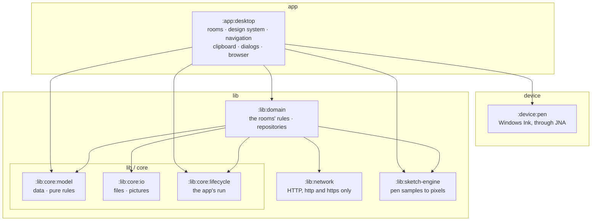
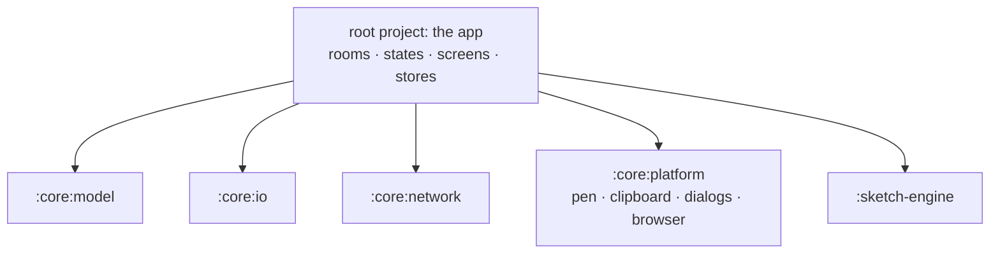

# ActionDraw's architecture

ActionDraw is built as Gradle modules in three groups. A module can use only what it declares as a
dependency, so the build — not a convention — holds the boundaries below. The steps that get
there are M10 in the [roadmap](../ROADMAP.md).

- **`lib`** — the library: everything that is neither a screen nor a device. No Compose and no
  JNA anywhere in it.
- **`app`** — the applications built on the library. Today there is one, `desktop`.
- **`device`** — the hardware the apps talk to natively. Today there is one, `pen`.

## Where it is going

## The rules

1. **`lib` knows nothing of `app` or `device`.** No Compose, no Swing, no JNA in it: it can be
   tested headless and used by an application that is not this desktop one.
2. **The core modules depend on nothing of ours**, and not on each other: `model`, `io` and
   `lifecycle` each stand alone.
3. **`lib:sketch-engine` is a library of its own.** It depends on nothing of ours and could be
   published without the rest.
4. **`lib:domain` is the only way to the files and the network.** It holds the repositories over
   the files and the rules the rooms follow. It takes `io` and `network` as `implementation`
   dependencies, so they are not on the app's classpath: no screen can read a file or go online
   by itself.
5. **A `device` module depends on nothing of ours.** The app wires it in.
6. **Only `app` holds Compose state.** The rooms live in `app:desktop` as packages and never reach
   into each other; what one needs of another is an interface it defines (`BoardHost`,
   `ConceptSource`, `SketchHost`, `PinTargets`), connected where the app is assembled.
7. **The files stay the truth.** A board is a folder plus a sidecar; there is no database. An
   index (search across boards, pictures by content) could later sit inside `lib:domain`
   without the app noticing.
8. **Package names stay when files move**, so a move changes no imports.

## What goes where

| Module | What it holds | Today |
|---|---|---|
| `:lib:core:model` | Boards and their cards, concepts, the session vocabulary; `CardLayout`, `ConceptLink` | `:core:model` (F11.1) |
| `:lib:core:io` | `AppDirs`, `SafeFile`, `Folders`; listing and decoding pictures, `ContentId`, path rules | `:core:io` (F11.2) |
| `:lib:core:lifecycle` | The app's run: the scope long-running work lives in, the dispatcher for disk work, closing down cleanly (pending saves written before the window goes) | new |
| `:lib:network` | `Http`, `Fetcher`: one GET, http and https only, a size cap | `:core:network` (F11.3) |
| `:lib:domain` | Repositories for boards, concepts, sketches, settings, practice history, the registries, pictures and their thumbnails, link previews; the rules inside today's state holders: board moves and deletes, groups, imports, practice selection, a session's sequence | spread over the app: `BoardStore`, `ConceptStore`, the registries, `Settings`, `SeenStore`, `RedoStore`, `ThumbCache`, `Importer`, `LinkPreview`, `ContactSheet`, `Palette`, and parts of `BoardState`, `ConceptState`, `SketchState`, `AppState` |
| `:lib:sketch-engine` | The drawing engine: strokes, leads, paper, the sketch document | `:sketch-engine` |
| `:device:pen` | `PenSample`, `PenSource`, `WindowsPointerSource` | in `:core:platform` (F11.4) |
| `:app:desktop` | `Main`, `App`, navigation; the four rooms with their UI state; the design system (Atelier, Materials, Motion, the room chrome); the desktop's own OS: `SystemClipboard`, `Browser`, `FileDialogs`, `SystemPreferences`, drag and drop | the root project, and the rest of `:core:platform` |

The one wrinkle: `SystemPreferences` reads Windows' animation setting through JNA, so
`app:desktop` keeps a small JNA dependency of its own beside `device:pen`.

## Where it stands

As of F11.4 (PR #21), before the move into `lib`, `app` and `device`:

The core modules already depend on nothing of ours. What is left: the move into the three groups
(F11.5), `lifecycle` (F11.6), `domain` (F11.7), and the app's screens talking only to their states
(F11.8).
