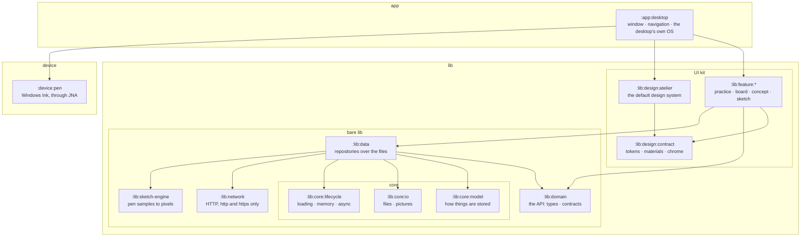
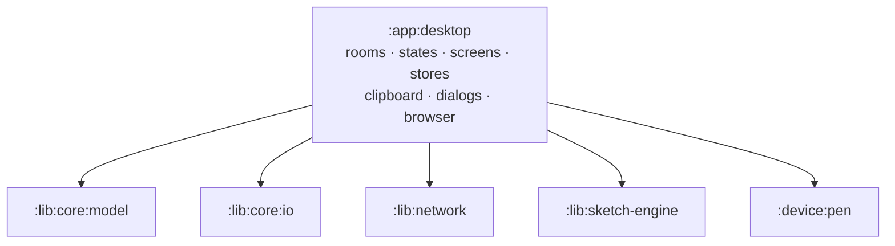

# ActionDraw's architecture

ActionDraw is built as Gradle modules in three groups. A module can use only what it declares as a
dependency, so the build — not a convention — holds the boundaries below. The steps that get
there are M10 in the [roadmap](../ROADMAP.md).

- **`lib`** — what an application builds on, in two halves:
  - the **bare lib**: `core` (`model`, `io`, `lifecycle`), `network`, `domain`, `data` and the
    `sketch-engine`. Headless, usable on its own, with no UI at all;
  - the **UI kit**: the design system (its contract and the default *atelier*) and the
    features, one per room — the convenient way of putting the bare lib to use, ready for a GUI.
- **`app`** — the applications on top. Today there is one, `desktop`.
- **`device`** — the hardware the apps talk to natively. Today there is one, `pen`.

## Where it is going

Simplified: `desktop` also sees `domain`, `lifecycle` and the design contract, `features` also see
`lifecycle` (and `sketch` the engine), and `atelier` also uses the engine for the paper's grain.

## The layers

- **`model`** — how things are stored: the sidecar formats (`BoardFile`, `ConceptFile`, …) and
  the pure rules on them. Not what callers see.
- **`io`** — files: the app's own folders, writing a file whole or not at all, moving and deleting
  folders, names Windows accepts, listing and decoding pictures.
- **`lifecycle`** — the lib's run: loading it, the scopes and dispatchers its async work runs in,
  the memory it holds while running (caches, what is open) and giving it back, and closing down
  cleanly — whatever is still to be written is written before the app goes.
- **`network`** — the one way online: a GET for http and https only, with a size cap.
- **`domain`** — the API: the types and contracts callers work with, abstracted from the model —
  just what an application needs. It also says, as contracts, what the lib needs from its host:
  the clipboard, choosing files, opening a link, the pen's input. It depends on nothing of ours.
- **`data`** — the implementation of the domain's contracts over `core` and `network`: the
  repositories over the files, mapping what is stored to what callers see, working off the UI
  thread through `lifecycle`.
- **`sketch-engine`** — the drawing engine, a library of its own.
- **`design:contract`** — the design system's contract: tokens (colours, type, lifts, motion),
  materials and room chrome as interfaces, read through the theme the way Material's
  `MaterialTheme` is.
- **`design:atelier`** — the default design system, in Compose: the atelier of
  [CONCEPT.md](../CONCEPT.md). Another design system implements the same contract.
- **`feature:*`** — a room as a unit: the domain contracts it adds in its own domain layer, its
  state and logic over `domain` and `data`, and its screens on the design contract.
- **`app:desktop`** — on top: the windows, navigation between the rooms, the design system chosen,
  the desktop's implementations of the host contracts (AWT clipboard, Swing dialogs, the
  desktop's browser, Windows' animation setting), and the pen wired in from `device:pen`.
- **`device:pen`** — the pen's own input: Windows Ink through JNA.

## The rules

1. **The bare lib has no UI**: no Compose, no Swing, no JNA. It can be tested headless and used
   by any application.
2. **The core modules stand alone**, depending on nothing of ours and not on each other.
3. **`domain` depends on nothing of ours.** It is the contract; everything else implements it,
   uses it or extends it.
4. **Only `data` reaches the files and the network.** It takes `io` and `network` as
   `implementation`, so they are on nobody else's classpath: no screen can read a file or go
   online by itself.
5. **`sketch-engine` depends on nothing of ours** and could be published without the rest.
6. **Nothing in the lib depends on a feature, and no feature on another.** What one room needs of
   another is a contract, in the domain or in the room's own domain layer, connected by the app.
7. **Features use the design contract, never `atelier` itself**, so another design system
   restyles them.
8. **Compose lives in the UI kit and the app**; the OS (Swing, AWT, JNA) only in the app and
   `device`.
9. **The files stay the truth.** A board is a folder plus a sidecar; there is no database. An
   index (search across boards, pictures by content) could later sit inside `data` without anyone
   above noticing.
10. **Package names stay when files move**, so a move changes no imports.

## What goes where

| Module | Comes from |
|---|---|
| `:lib:core:model` | `:core:model` (F11.1) |
| `:lib:core:io` | `:core:io` (F11.2) |
| `:lib:core:lifecycle` | new; today each state picks its own `Dispatchers.IO`, and nothing is flushed on close |
| `:lib:network` | `:core:network` (F11.3) |
| `:lib:domain` | new: types for boards, cards, concepts, sketches, practice; the contracts for them; the host contracts, today `SystemClipboard`, `Browser`, `FileDialogs` and `PenSource` |
| `:lib:data` | `BoardStore`, `ConceptStore`, the registries, `Settings`, `SeenStore`, `RedoStore`, `ThumbCache`, `Importer`, `LinkPreview`, `ContactSheet`, `Palette`, and the storage inside `BoardState`, `ConceptState`, `SketchState`, `AppState` |
| `:lib:sketch-engine` | `:sketch-engine` |
| `:lib:design:contract` | new: what `ui/Atelier`, `Materials`, `Motion` and the room chrome offer, as a contract |
| `:lib:design:atelier` | `ui/Atelier.kt`, `Materials.kt`, `Motion.kt`, `RoomChrome.kt`, `Components.kt`, the fonts |
| `:lib:feature:practice` | `AppState` and the Practice room's screens (`ui/PracticeScreen`, `SessionScreen`, the glass, …) |
| `:lib:feature:board` | `BoardState` and `board/ui` |
| `:lib:feature:concept` | `ConceptState` and `concept/ui` |
| `:lib:feature:sketch` | `SketchState` and `sketch/ui` |
| `:app:desktop` | `Main`, `App`, the palette home, the windows; the AWT, Swing and JNA sides of `:core:platform` |
| `:device:pen` | `PenSample`, `PenSource`'s Windows side, `WindowsPointerSource` (in `:core:platform`) |

## Where it stands

After F11.5 the modules sit in their three groups; what each holds has not changed yet:

The rest comes in this order: the three
groups (F11.5), `lifecycle` (F11.6), `domain` (F11.7), `data` (F11.8), the design system (F11.9),
the features (F11.10) and the desktop on top (F11.11).
